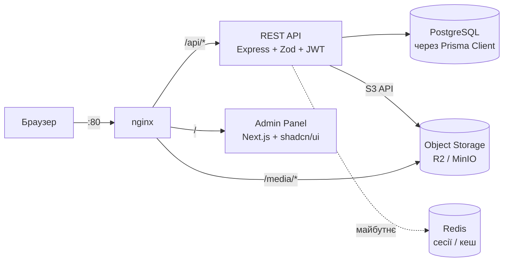
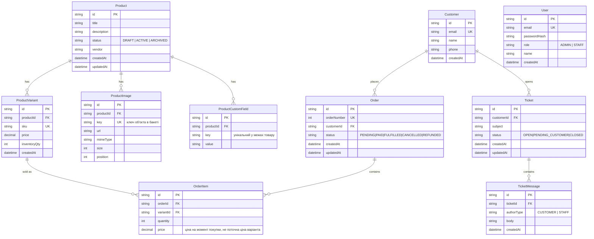
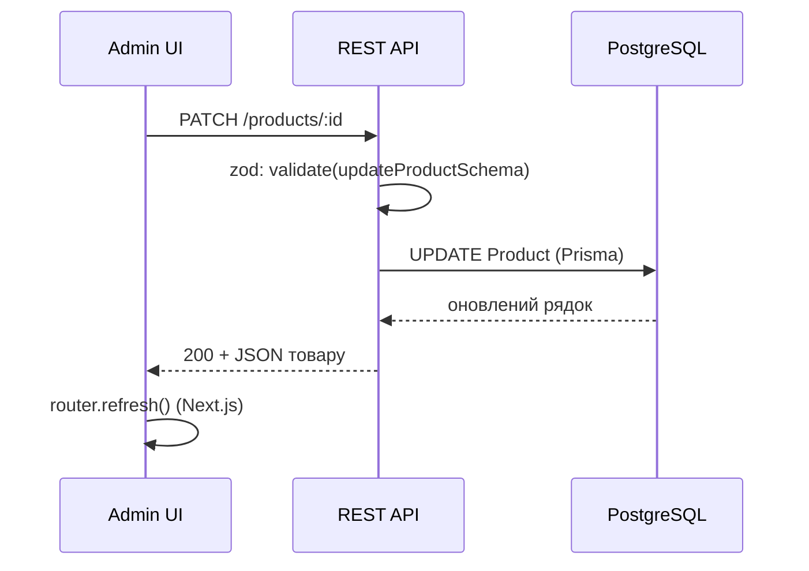
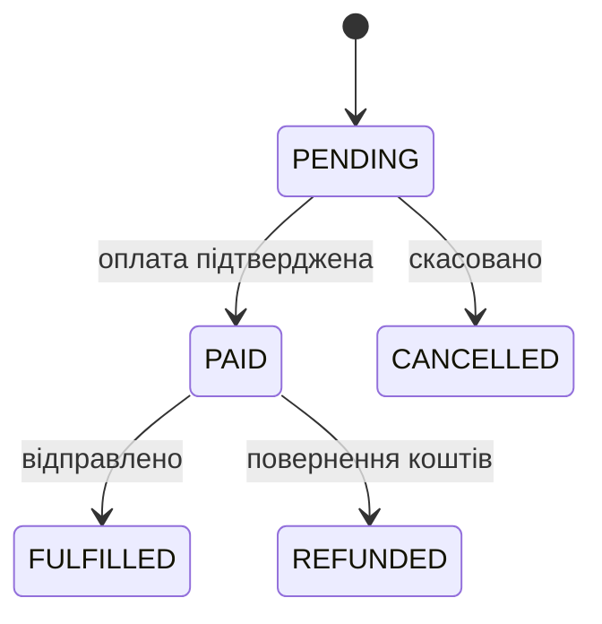
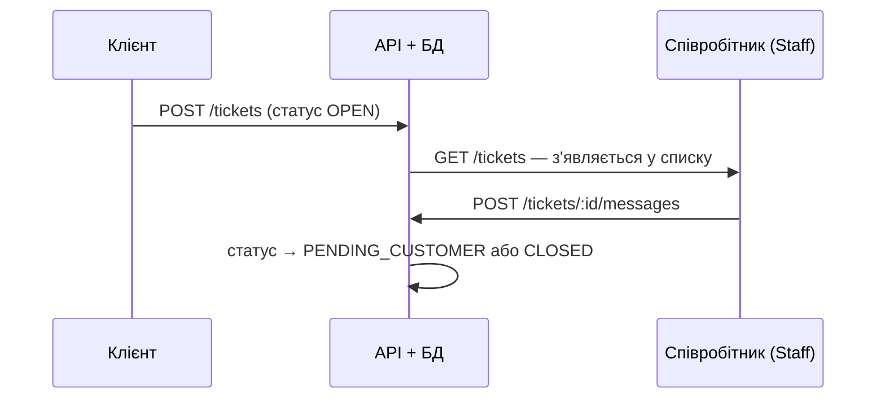

# StoreFront — дизайн системи

Технічна основа для розробки: архітектура, модель даних, API, флоу
ключових процесів і стейт-менеджмент на фронті. Підзавдання 1 з
брифу — до початку реалізації (Підзавдання 2).

Статус: частина позначеного тут уже реалізована (Етапи 0-4, див.
[README.md](README.md)); решта — план на наступні етапи. Де це
важливо, позначено явно.

**Відхилення від брифу:** UI-бібліотека — shadcn/ui, не Polaris.
`@shopify/polaris` (React) офіційно deprecated; заміна ("Polaris web
components") розрахована на застосунки, вбудовані в саму адмінку
Shopify, а не на окремий сервіс на кшталт нашого. Деталі —
`frontend/README.md`.

---

## 1. Архітектура

Три самостійні частини, що спілкуються по мережі, а не через спільний
код: адмін-панель ніколи не бачить базу напряму, вся логіка й
валідація — на бекенді. `nginx` — єдина точка входу ззовні; жоден
інший сервіс не публікує порт на хост (детальніше — Reverse Proxy
Primer, обговорений окремо).



Постгрес, бекенд і (з Етапу 3) фронтенд живуть тільки у внутрішній
docker-мережі — `expose`, не `ports`. Підключення до бази — по паролю,
а не по відкритому порту.

---

## 2. Модель даних

### 2.1 Реалізовано (Етапи 1-7)



`User` — персонал, що логіниться в адмінку (`ADMIN`/`STAFF`). Покупці
(`Customer`, нижче) — окрема модель: різний спосіб "входу" (не
логіняться напряму в MVP) і різні права, тому окрема таблиця, а не
ще одна роль у `User`.

`ProductCustomField` — довільні пари ключ-значення на товарі
(на кшталт Shopify metafields), а не JSON-блоб на варіанті: так кожне
поле можна редагувати/видаляти окремим REST-запитом, і воно
має власну гарантію унікальності на рівні БД (`@@unique([productId, key])`).

На відміну від `Order.status`, `Ticket.status` не має таблиці
дозволених переходів — міняється вільно в будь-якому напрямку.
Діалог підтримки не такий лінійний, як оплата замовлення (клієнт може
написати в уже закритий тікет; персонал може відкрити тікет назад
без формального "скасування"), а бриф вимагав лише перегляд і
відповідь/закриття.

Зовнішні ключі (`productId`, `orderId`, `variantId`, `ticketId`,
`customerId`) отримують явний `@@index([...])` у Prisma-схемі —
Prisma **не** створює такий індекс автоматично (перевірено на
`ProductVariant`/`ProductImage`, детальніше — Postgres Index Lab).

---

## 3. API

REST, JSON. Ролі перевіряються middleware на бекенді — клієнт нічому,
що приходить із фронту, не довіряється повторно.

### Auth

| Метод і шлях | Опис | Роль | Статус |
|---|---|---|---|
| `POST /api/auth/login` | Вхід, видає httpOnly-куку з JWT | Public | ✅ |
| `POST /api/auth/logout` | Видаляє куку | Staff | ✅ |
| `GET /api/auth/me` | Поточний користувач | Staff | ✅ |

### Products

| Метод і шлях | Опис | Роль | Статус |
|---|---|---|---|
| `GET /api/products` | Список; `page`/`limit`, фільтр `status`, пошук `search` за назвою | Staff | ✅ |
| `POST /api/products` | Створити товар | Staff | ✅ |
| `GET /api/products/:id` | Товар з варіантами, зображеннями, кастомними полями | Staff | ✅ |
| `PATCH /api/products/:id` | Оновити поля товару | Staff | ✅ |
| `DELETE /api/products/:id` | Архівувати (`status: ARCHIVED`, не DELETE-рядок) | **Admin** | ✅ |
| `POST /api/products/:id/images` | Завантажити зображення в сховище (multipart, `file`, до 5 МБ) | Staff | ✅ |
| `DELETE /api/products/:id/images/:imageId` | Видалити зображення (запис і файл) | Staff | ✅ |
| `POST /api/products/:id/variants` | Додати варіант | Staff | ✅ |
| `PATCH /api/products/:id/variants/:variantId` | Оновити варіант | Staff | ✅ |
| `DELETE /api/products/:id/variants/:variantId` | Видалити варіант | Staff | ✅ |
| `GET /api/products/:id/custom-fields` | Список кастомних полів | Staff | ✅ |
| `POST /api/products/:id/custom-fields` | Додати поле | Staff | ✅ |
| `PATCH /api/products/:id/custom-fields/:fieldId` | Оновити значення | Staff | ✅ |
| `DELETE /api/products/:id/custom-fields/:fieldId` | Видалити поле | Staff | ✅ |

### Orders

| Метод і шлях | Опис | Роль | Статус |
|---|---|---|---|
| `GET /api/orders` | Список, фільтр за статусом, порахований `total` | Staff | ✅ |
| `GET /api/orders/:id` | Деталі з позиціями й `allowedTransitions` | Staff | ✅ |
| `PATCH /api/orders/:id/status` | Змінити статус (лише дозволений перехід, інакше `409`) | Staff | ✅ |

### Tickets

| Метод і шлях | Опис | Роль | Статус |
|---|---|---|---|
| `GET /api/tickets` | Список звернень, фільтр за статусом | Staff | ✅ |
| `GET /api/tickets/:id` | Тікет з листуванням | Staff | ✅ |
| `POST /api/tickets/:id/messages` | Відповісти клієнту (`close: true` — заразом закрити) | Staff | ✅ |
| `PATCH /api/tickets/:id/status` | Змінити статус вручну, без обмежень переходу | Staff | ✅ |

### Analytics

| Метод і шлях | Опис | Роль | Статус |
|---|---|---|---|
| `GET /api/analytics/summary` | Виручка, к-сть замовлень, нові клієнти, топ-5 товарів, щоденний ряд для графіків; опційно `?days=N` | Staff | ✅ |

Виручка — сума позицій замовлень у статусі `PAID`/`FULFILLED`;
`PENDING` (не оплачено) і `REFUNDED` (повернено) у суму не йдуть.
Без `days` — за весь час (щоденний ряд для графіків — останні 90 днів).

---

## 4. Флоу ключових процесів

### 4.1 Редагування товару



### 4.2 Обробка замовлення — статуси



Дозволені переходи перевіряються на бекенді в `PATCH
/orders/:id/status` — статус не можна змінити в довільному порядку
загальним `PATCH /orders/:id` (такого ендпоінта для статусу немає
навмисно).

### 4.3 Звернення клієнта в підтримку



### 4.4 Авторизація і розмежування ролей

```mermaid
sequenceDiagram
    participant B as Браузер
    participant A as REST API
    participant D as PostgreSQL
    B->>A: POST /auth/login {email, password}
    A->>D: SELECT user WHERE email = ...
    D-->>A: passwordHash, role
    A->>A: bcrypt.compare + підпис JWT {userId, role}
    A-->>B: Set-Cookie token (httpOnly, sameSite=lax)
    Note over B,A: наступні запити — кука автоматично;<br/>requireAuth перевіряє підпис,<br/>requireRole звіряє роль
```

JWT у httpOnly-кукі, а не в `localStorage` чи заголовку
`Authorization`: токен ніколи не потрапляє в JS на фронті, тож XSS не
може його вкрасти.

---

## 5. Стейт-менеджмент на фронті

Правило: **дані з бази не дублюються в Zustand.** Zustand — лише для
стану, що існує тільки в браузері й зникає при перезавантаженні.

| Zustand (клієнтський UI-стан) | Сервер (не в Zustand) |
|---|---|
| Відкрита/закрита модалка чи діалог | Списки й картки товарів, замовлень, тікетів |
| Вибрані рядки для масової дії | Дані аналітики |
| Чернетка форми товару до "Зберегти" | Отримуються Server Components / fetch на сервері Next.js |
| Стан фільтрів, поки не застосовані | Після мутації — `router.refresh()`, без ручного кешу |
| Згорнута/розгорнута навігація | Складніший кеш (optimistic update) — пізніше, TanStack Query, не в MVP |

---

## 6. AI-асистенти в процесі розробки

Уся розробка велась у парі з **Claude Code** (десктопний застосунок,
агентний режим: читає й пише файли, запускає команди в терміналі й
Docker, ганяє тести). Моделі — сімейство Claude Sonnet; у кожному коміті
це видно з трейлера `Co-Authored-By`. Інші AI-асистенти (Cursor тощо) не
використовувались.

### 6.1 Інструменти й для чого

| Інструмент | Що з ним робилось |
|---|---|
| **Claude Code** (агент у репозиторії) | генерація коду (бекенд, фронтенд, тести, міграції), рефакторинг, запуск `tsc`/`jest`/`eslint`/`curl`/`psql` у контейнерах, коміти |
| **Вбудований браузер Claude** | живе проходження UI після кожного етапу: логін → список → картка → дія; читання консолі (так знайдено помилки гідратації) |
| **Claude Artifacts** | супровідна документація: Build Log (усі команди по порядку), Blueprint, Postgres Index Lab, Reverse Proxy Primer — розбори, зроблені, щоб *зрозуміти*, а не лише отримати код |
| **Skill `dataviz`** | правила для графіків дашборда: тонкі стовпчики, один колір на серію, підказка, таблиця-дубль для доступності |

### 6.2 Етап → що робив ШІ

Коміти — із `git log`; помилки й виправлення — з Build Log.

| Етап (коміт) | Генерація | Рефакторинг | Дебаг |
|---|---|---|---|
| **0 — Ініціалізація** (`09ab809`) | скелет репозиторію, `docker-compose.yml`, README | — | перевірка, що compose піднімається |
| **1 — Бекенд** (`5491080`) | Express + Prisma 7 + JWT, middleware ролей, zod-схеми, 8 тестів | — | CLI `prisma` (rc) і `@prisma/client` розійшлись по версіях; `P1012` — `datasource.url` більше не в схемі → `prisma.config.ts` + driver adapter; `P1010` виявився конфліктом порту 5432 з нативним Postgres (знайдено через `lsof`, контейнер переїхав на 5433) |
| **nginx** (`2cf65bb`) | `nginx.conf`, Dockerfile-и | переробка Етапу 0/1: секрети з `.env` у compose, жодного опублікованого порту крім 80 | перевірка `nc -z`, що порти реально закриті |
| **2 — Товари** (`058a7f1`, `c7714e2`) | CRUD товарів/варіантів, пошук, кастомні поля, до 36 тестів | — | дубль SKU давав `500` замість `409` — форма `P2002` під driver adapter інша (`meta.target` порожній); `nodemon` не перезапускається після `prisma generate` (502); помилки `tsc` (клієнт не перегенеровано, `string \| string[]` у `req.params`) |
| **3 — Адмінка** (`48c4d44`, `5b82028`, `e91095e`) | Next.js 16, shadcn/ui, логін, список/картка/форми товарів, Server Actions | прибрано невикористані `sidebar`/`sheet` і згенерований `use-mobile.ts`, що ламав lint | Polaris виявився deprecated + конфлікт React 18/19 → перехід на shadcn (рішення погоджено); `asChild` не існує в Base UI → `render`; колізія `/products/new` з `/products/[id]`; nginx не успадковував `Host` → "Invalid Server Actions request"; `defaultValue` не оновлювався → `key={updatedAt}` |
| **4 — Замовлення** (`37be1da`) | моделі, стейт-машина переходів (`ALLOWED_TRANSITIONS`), список/деталі, 48 тестів | — | нових помилок не було (пастка `nodemon` уже відома) |
| **5 — Підтримка** (`8062c69`) | `Ticket`/`TicketMessage`, відповідь+статус однією `$transaction`, UI, 57 тестів | трюк `key` з Етапу 3 повторно застосовано до форми відповіді | не той npm-скрипт для сіда (`seed` → `prisma:seed`) |
| **6 — Аналітика** (`6706b78`, `72acbbb`) | агрегація виручки/замовлень/клієнтів/топ-товарів, щоденний ряд, свій `BarChart`, 65 тестів | прибрано мертву гілку "ще не готово" в навігації, що зламала типи | функцію не можна передати Server → Client Component; `Intl` у Node дає "грн", у браузері "₴" → помилка гідратації; накладання підпису осі на заголовок, дробові поділки осі замовлень |

### 6.3 Як перевірялась робота ШІ

Код від ШІ не приймався "на слово" — після кожного кроку:

- `tsc --noEmit` і `eslint` у контейнері;
- юніт-тести (Prisma замокано), реальні помилки Prisma відтворюються справжнім `PrismaClientKnownRequestError`;
- `curl` крізь nginx — і успішні шляхи, і `400`/`401`/`404`/`409`;
- звірка з базою напряму (`psql`), щоб відповідь API збігалась із даними (приклад: дашборд — 3 замовлення й 2 клієнти за 13 вересня);
- проходження UI в браузері, включно з порожніми станами.

### 6.4 Де ШІ помилявся — і що це дало

Помилки ШІ ловились саме цією перевіркою, а не припущеннями:

- написав дублікат-перевірку за класичною формою `P2002` — під driver adapter вона не спрацьовувала; виправлено за реальним логом і закріплено тестом;
- не врахував конфлікт портів із нативним Postgres — діагностика пішла від "користувача відхилено" до `lsof`;
- передав форматер-функцію з Server Component у клієнтський графік — впало в dev-оверлеї;
- використав `Intl` для валюти в клієнтському компоненті — розбіжність Node/браузер дала помилку гідратації, знайдену лише в консолі браузера;
- при оновленні документації випадково обрізав кінець `frontend/README.md` — помічено в `git diff` перед комітом, відновлено з `HEAD`.

Інші знахідки, що лишились у проєкті як знання:

- `req.query` в Express 5 — тільки для читання (тому валідований запит кладеться в `req.validatedQuery`);
- `nodemon` ігнорує `node_modules`, тож після `prisma generate` бекенд треба перезапускати вручну (`docker compose restart backend`).

Повна хронологія команд і файлів по кожному етапу — у StoreFront Build Log.
