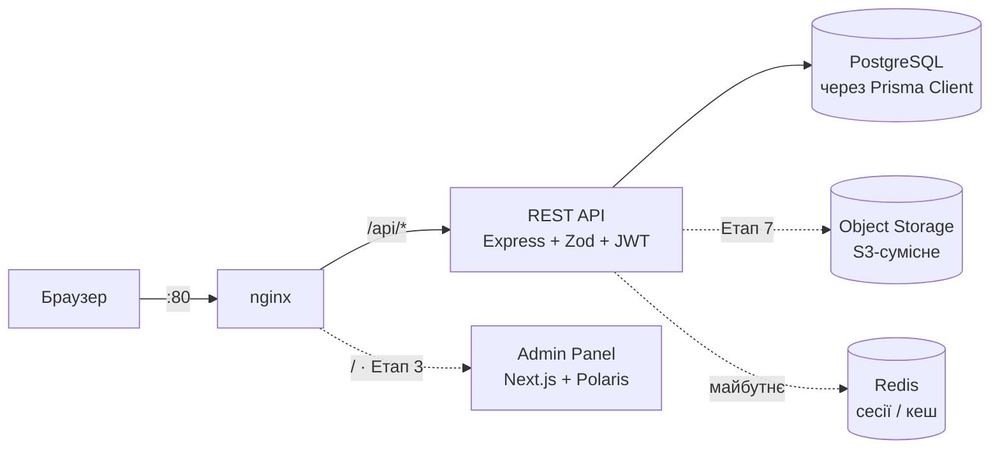
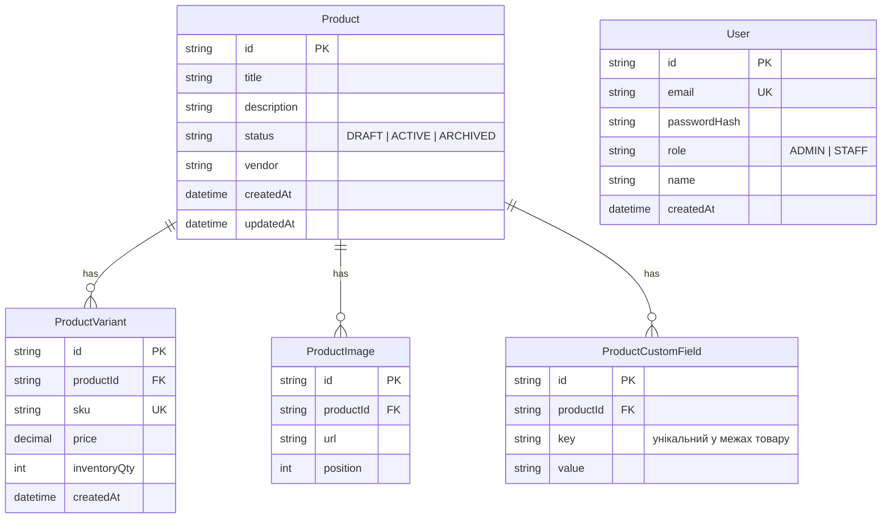
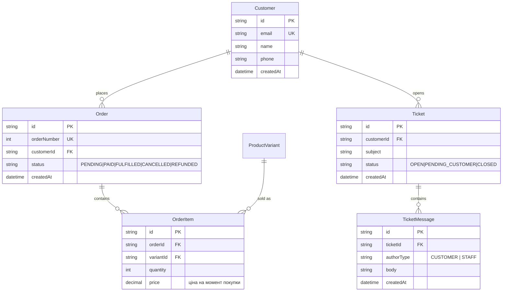
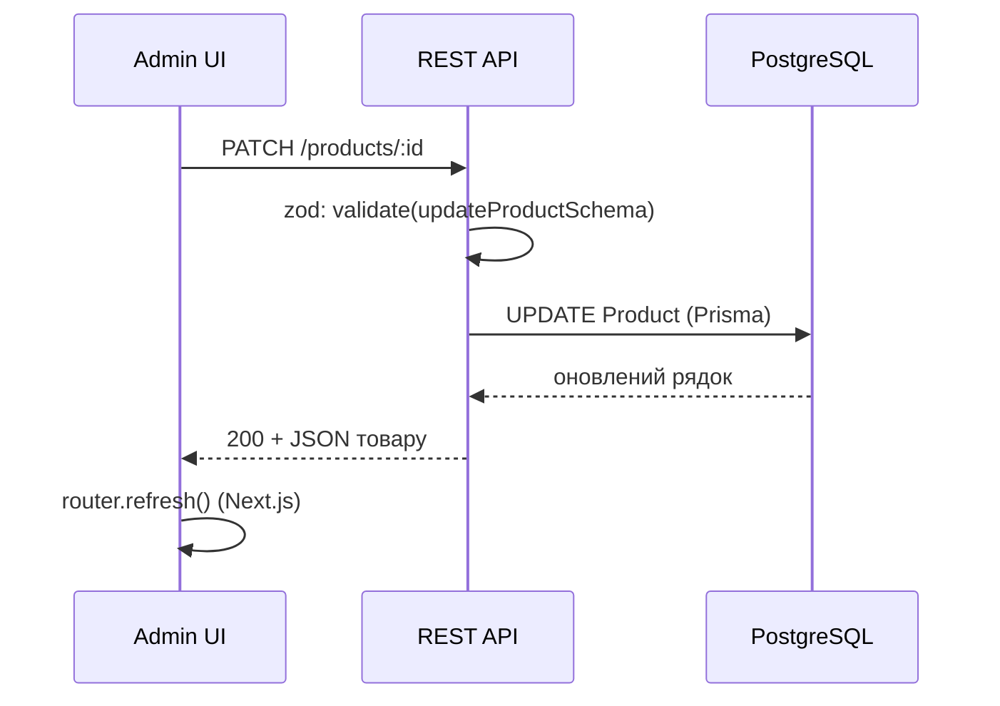
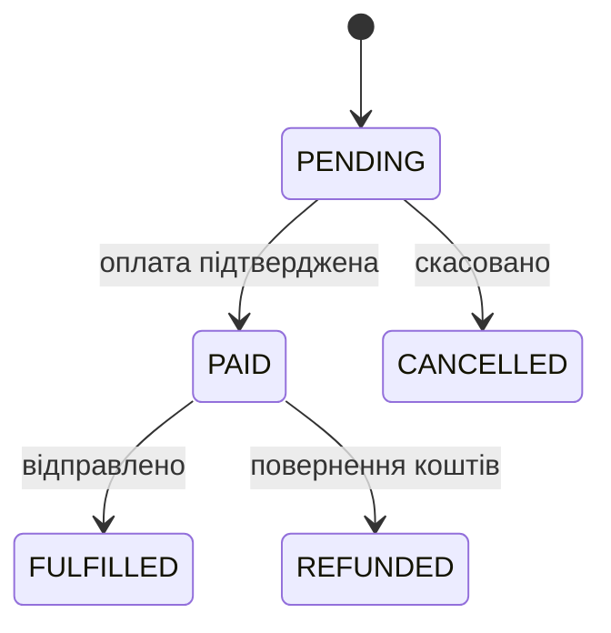
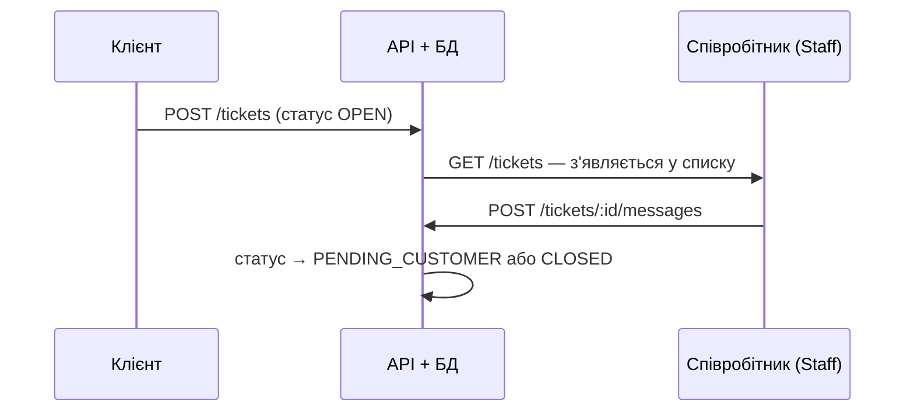

# StoreFront — дизайн системи

Технічна основа для розробки: архітектура, модель даних, API, флоу
ключових процесів і стейт-менеджмент на фронті. Підзавдання 1 з
брифу — до початку реалізації (Підзавдання 2).

Статус: частина позначеного тут уже реалізована (Етапи 0-2, див.
[README.md](README.md)); решта — план на наступні етапи. Де це
важливо, позначено явно.

---

## 1. Архітектура

Три самостійні частини, що спілкуються по мережі, а не через спільний
код: адмін-панель ніколи не бачить базу напряму, вся логіка й
валідація — на бекенді. `nginx` — єдина точка входу ззовні; жоден
інший сервіс не публікує порт на хост (детальніше — Reverse Proxy
Primer, обговорений окремо).



Постгрес, бекенд і (з Етапу 3) фронтенд живуть тільки у внутрішній
docker-мережі — `expose`, не `ports`. Підключення до бази — по паролю,
а не по відкритому порту.

---

## 2. Модель даних

### 2.1 Реалізовано (Етапи 1-2)



`User` — персонал, що логіниться в адмінку (`ADMIN`/`STAFF`). Покупці
(`Customer`, нижче) — окрема модель: різний спосіб "входу" (не
логіняться напряму в MVP) і різні права, тому окрема таблиця, а не
ще одна роль у `User`.

`ProductCustomField` — довільні пари ключ-значення на товарі
(на кшталт Shopify metafields), а не JSON-блоб на варіанті: так кожне
поле можна редагувати/видаляти окремим REST-запитом, і воно
має власну гарантію унікальності на рівні БД (`@@unique([productId, key])`).

### 2.2 Заплановано (Етапи 4-5)



Зовнішні ключі (`productId`, `orderId`, `variantId`, `ticketId`,
`customerId`) отримують явний `@@index([...])` у Prisma-схемі —
Prisma **не** створює такий індекс автоматично (перевірено на
`ProductVariant`/`ProductImage`, детальніше — Postgres Index Lab).

---

## 3. API

REST, JSON. Ролі перевіряються middleware на бекенді — клієнт нічому,
що приходить із фронту, не довіряється повторно.

### Auth

| Метод і шлях | Опис | Роль | Статус |
|---|---|---|---|
| `POST /api/auth/login` | Вхід, видає httpOnly-куку з JWT | Public | ✅ |
| `POST /api/auth/logout` | Видаляє куку | Staff | ✅ |
| `GET /api/auth/me` | Поточний користувач | Staff | ✅ |

### Products

| Метод і шлях | Опис | Роль | Статус |
|---|---|---|---|
| `GET /api/products` | Список; `page`/`limit`, фільтр `status`, пошук `search` за назвою | Staff | ✅ |
| `POST /api/products` | Створити товар | Staff | ✅ |
| `GET /api/products/:id` | Товар з варіантами, зображеннями, кастомними полями | Staff | ✅ |
| `PATCH /api/products/:id` | Оновити поля товару | Staff | ✅ |
| `DELETE /api/products/:id` | Архівувати (`status: ARCHIVED`, не DELETE-рядок) | **Admin** | ✅ |
| `POST /api/products/:id/variants` | Додати варіант | Staff | ✅ |
| `PATCH /api/products/:id/variants/:variantId` | Оновити варіант | Staff | ✅ |
| `DELETE /api/products/:id/variants/:variantId` | Видалити варіант | Staff | ✅ |
| `GET /api/products/:id/custom-fields` | Список кастомних полів | Staff | ✅ |
| `POST /api/products/:id/custom-fields` | Додати поле | Staff | ✅ |
| `PATCH /api/products/:id/custom-fields/:fieldId` | Оновити значення | Staff | ✅ |
| `DELETE /api/products/:id/custom-fields/:fieldId` | Видалити поле | Staff | ✅ |

### Orders

| Метод і шлях | Опис | Роль | Статус |
|---|---|---|---|
| `GET /api/orders` | Список, фільтр за статусом | Staff | 🔜 Етап 4 |
| `GET /api/orders/:id` | Деталі з позиціями | Staff | 🔜 Етап 4 |
| `PATCH /api/orders/:id/status` | Змінити статус (з перевіркою допустимого переходу) | Staff | 🔜 Етап 4 |

### Tickets

| Метод і шлях | Опис | Роль | Статус |
|---|---|---|---|
| `GET /api/tickets` | Список звернень, фільтр за статусом | Staff | 🔜 Етап 5 |
| `GET /api/tickets/:id` | Тікет з листуванням | Staff | 🔜 Етап 5 |
| `POST /api/tickets/:id/messages` | Відповісти клієнту | Staff | 🔜 Етап 5 |
| `PATCH /api/tickets/:id/status` | Закрити / повернути в роботу | Staff | 🔜 Етап 5 |

### Analytics

| Метод і шлях | Опис | Роль | Статус |
|---|---|---|---|
| `GET /api/analytics/summary` | Виручка, к-сть замовлень, топ-товари | Staff | 🔜 Етап 6 |

---

## 4. Флоу ключових процесів

### 4.1 Редагування товару



### 4.2 Обробка замовлення — статуси



Дозволені переходи перевіряються на бекенді в `PATCH
/orders/:id/status` — статус не можна змінити в довільному порядку
загальним `PATCH /orders/:id` (такого ендпоінта для статусу немає
навмисно).

### 4.3 Звернення клієнта в підтримку



### 4.4 Авторизація і розмежування ролей

```mermaid
sequenceDiagram
    participant B as Браузер
    participant A as REST API
    participant D as PostgreSQL
    B->>A: POST /auth/login {email, password}
    A->>D: SELECT user WHERE email = ...
    D-->>A: passwordHash, role
    A->>A: bcrypt.compare + підпис JWT {userId, role}
    A-->>B: Set-Cookie token (httpOnly, sameSite=lax)
    Note over B,A: наступні запити — кука автоматично;<br/>requireAuth перевіряє підпис,<br/>requireRole звіряє роль
```

JWT у httpOnly-кукі, а не в `localStorage` чи заголовку
`Authorization`: токен ніколи не потрапляє в JS на фронті, тож XSS не
може його вкрасти.

---

## 5. Стейт-менеджмент на фронті

Правило: **дані з бази не дублюються в Zustand.** Zustand — лише для
стану, що існує тільки в браузері й зникає при перезавантаженні.

| Zustand (клієнтський UI-стан) | Сервер (не в Zustand) |
|---|---|
| Відкрита/закрита модалка чи тост Polaris | Списки й картки товарів, замовлень, тікетів |
| Вибрані рядки для масової дії | Дані аналітики |
| Чернетка форми товару до "Зберегти" | Отримуються Server Components / fetch на сервері Next.js |
| Стан фільтрів, поки не застосовані | Після мутації — `router.refresh()`, без ручного кешу |
| Згорнута/розгорнута навігація | Складніший кеш (optimistic update) — пізніше, TanStack Query, не в MVP |

---

## 6. AI-асистенти в процесі розробки

Проєкт розробляється в парі з Claude Code — генерація коду, дебаг і
рефакторинг. Детальний журнал: хронологія всіх команд і файлів — у
StoreFront Build Log; окремо задокументовані нетривіальні знахідки
(не вигадані для навчання, спіймані по ходу):

- конфлікт порту 5432 з нативним Postgres на машині розробника;
- Prisma 7: `datasource.url` більше не читається зі `schema.prisma`, конекшн-стрінг переїхав у `prisma.config.ts` + driver adapter;
- форма помилки `P2002` під `@prisma/adapter-pg` інша, ніж у класичному Prisma-клієнті (`meta.target` порожній, реальне ім'я constraint'у — в `meta.driverAdapterError.cause.constraint.index`);
- `req.query` в Express 5 — тільки для читання;
- `nodemon` ігнорує `node_modules`, тож не перезапускається сам після `prisma generate`.

Кожна знахідка підтверджена реальним логом/помилкою і закрита тестом,
а не просто виправлена "на очах".
